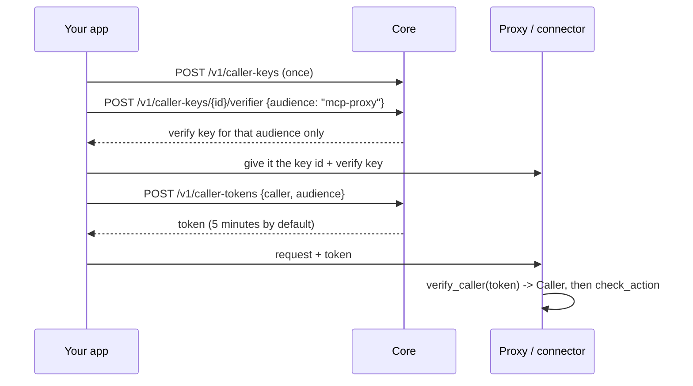

# Signed caller tokens

A caller is "who this action is for", for example the end user your support agent is
helping. Rules use it to decide things like "only this user's own orders".

When your app calls Core with its API key, Core trusts the `caller` you send, because the
key already proves which app is calling. But a proxy or connector sitting between an
agent and its tools has no such key. A caller token lets it trust the caller anyway: your
app (or Core) signs the caller, and the proxy checks the signature.



## In Core

| Call | What it does |
| --- | --- |
| `POST /v1/caller-keys` | Makes a signing key. Its secret stays in Core. At most 5 active per workspace |
| `POST /v1/caller-keys/{id}/verifier` | Returns the verify key for one `audience` (base64url). Refused for `x0r-core` |
| `GET /v1/caller-keys` | Lists keys, without secrets |
| `DELETE /v1/caller-keys/{id}` | Revokes a key. Every run that starts afterwards refuses its tokens |
| `POST /v1/caller-tokens` | Signs `{caller, audience, ttl_seconds}` with the newest active key |
| `POST /v1/agents/{id}/run` | Accepts `caller_token` instead of `caller` (not both). The audience must be `x0r-core` |

A bad token stops the run before it starts: `401` with `detail.reason` set to one of
`caller_signature_invalid`, `caller_expired`, `caller_wrong_audience` or
`caller_token_malformed`. A bad token never becomes "no caller".

## Keys per audience

Each token is signed with a key derived from the root secret for its audience:
`audience_key(root, audience)`. A proxy gets only the key for its own audience. With it,
the proxy can check tokens meant for it, but it can't check or make tokens for any other
audience, and never for Core (`x0r-core`), whose key never leaves Core.

That key is still symmetric: whoever holds it could also make tokens for that one
audience. So give each proxy its own audience name, and trust it only for that audience.

## In your own code

Without Core, you hold the root secret yourself (at least 32 random bytes):

```python
from x0r_core.guard import Caller, CallerTokenError, audience_key, sign_caller, verify_caller

token = sign_caller(Caller("user-42", {"orders": ("A-1", "A-2")}),
                    key_id="ck_1", secret=ROOT, audience="mcp-proxy", ttl=300)

proxy_keys = {"ck_1": audience_key(ROOT, "mcp-proxy")}   # all the proxy gets
try:
    caller = verify_caller(token, keys=proxy_keys, audience="mcp-proxy")
except CallerTokenError as err:
    deny(err.reason)
```

## The token

`x0r.v1.<payload>.<signature>`, where the payload is base64url JSON
`{"kid", "sub", "attrs", "aud", "iat", "exp"}` and the signature is HMAC-SHA256 over
`x0r.v1.<payload>`, keyed with the audience key. Standard library only.

| Rule | Value |
| --- | --- |
| Lifetime | 5 minutes by default, 24 hours at most |
| Clock leeway | 30 seconds either way |
| Token size | at most 8,192 characters |
| Secret | at least 32 bytes |
| Attributes | up to 20. Each value is a string (200 characters) or a list of up to 100 strings |
| Audience | must match exactly, so a token for one service can't be replayed at another |

Attribute lists are matched by exact membership. `{"orders": ["A-1", "A-2"]}` reaches a
rule as `("A-1", "A-2")`, and nothing is split on commas.

## Rotating keys

1. Create a new key and give its verify key to your proxies next to the old one.
   `verify_caller` accepts any key in `keys`.
2. Core signs new tokens with the newest key on its own.
3. When old tokens have expired, revoke the old key in Core and remove it from your
   proxies.

## Limits

- No revocation list for single tokens. Keep lifetimes short. Revoking a key makes Core
  refuse its tokens for every run that starts afterwards. A run that already checked its
  token keeps going. A proxy holding a verify key stops accepting tokens only when you
  remove the key from it.
- Root secrets are stored in Core's database as is, because signing needs them. Protect
  the database like the API key table.
- Anyone with the workspace API key can mint a token for any caller. The token proves
  that the app vouched for the caller. It doesn't prove the user logged in.
