# How X0R Core works inside

A guided tour of the backend, from the big picture down to single functions. Read it top to
bottom once; after that, use the [cheat sheet](#16-where-to-change-what) at the end.

**Contents**

1. [Core in one minute](#1-core-in-one-minute)
2. [The code map](#2-the-code-map)
3. [Startup](#3-startup)
4. [A request and its API key](#4-a-request-and-its-api-key)
5. [Documents: ingest and chunking](#5-documents-ingest-and-chunking)
6. [Search](#6-search)
7. [The agent run loop](#7-the-agent-run-loop)
8. [The guard](#8-the-guard)
9. [Tools](#9-tools)
10. [Model providers](#10-model-providers)
11. [Usage and quota](#11-usage-and-quota)
12. [Evals](#12-evals)
13. [The database](#13-the-database)
14. [Settings](#14-settings)
15. [Limits and weak spots](#15-limits-and-weak-spots)
16. [Where to change what](#16-where-to-change-what)

---

## 1. Core in one minute

Think of Core as an office building:

| Part of the building | In the code | What it does |
| --- | --- | --- |
| Reception desk | `api/v1.py`, `deps.py` | Checks your badge (API key), finds your company (workspace), takes your request |
| Offices | `services/` | Do the real work: store documents, search, run agents, grade them, count tokens |
| Security guard at the tool room | `guard/` | Decides if an agent may use a tool, **before** it touches anything, and writes it down |
| Tool room | `tools/` | The things an agent can do: search documents, do math, fetch a web page |
| Phone line to the AI | `providers/` | Talks to the model: a fake offline one (mock) or any OpenAI-style API |
| Archive | `models.py`, `db.py` | Every table, in SQLite (default) or Postgres |

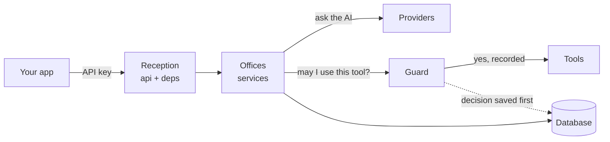

Three ideas run through the whole codebase:

- **Everything belongs to a workspace.** Every query filters by the workspace that the API key
  belongs to. One customer can never read another's data.
- **Deny by default.** A tool runs only when both the agent and the operator allow it and
  every check passes. If a check crashes, the answer is "no".
- **Evidence first.** Every guard decision is saved, with a stable reason code, before the
  action happens.

---

## 2. The code map

```
src/x0r_core/
├── main.py            builds the FastAPI app, creates tables on startup
├── cli.py             the `x0r` command: serve, init, seed, keys, smoke, security-demo
├── config.py          Settings: every X0R_* environment variable
├── db.py              database engine, sessions, startup table setup
├── models.py          the 9 tables (SQLAlchemy classes)
├── schemas.py         request and response shapes (Pydantic), with size limits
├── deps.py            API key → workspace; bootstrap token check
├── security.py        API key format and hashing
├── policy.py          Core's door into the guard
├── security_demo.py   offline demo: one denied tool call, one allowed
├── api/v1.py          all HTTP routes under /v1
├── guard/engine.py    the rules (standard library only)
├── guard/sdk.py       wrap(): the guard around any OpenAI-style client
├── guard/identity.py  sign_caller / verify_caller: signed caller tokens
├── services/
│   ├── agents.py      the agent loop
│   ├── ingest.py      save a document, split it, embed it
│   ├── chunking.py    the splitting algorithm
│   ├── retrieval.py   hybrid search
│   ├── evals.py       run test questions, score answers
│   └── usage.py       token meter and monthly quota
├── tools/
│   ├── base.py        what a Tool is
│   └── builtin.py     knowledge_search, calculator, http_get
└── providers/
    ├── base.py        what a Provider is
    ├── mock.py        offline, predictable provider
    ├── openai_compat.py any OpenAI-style endpoint
    └── registry.py    picks a provider by name
```

**Who may import whom.** Arrows point at what a file uses.

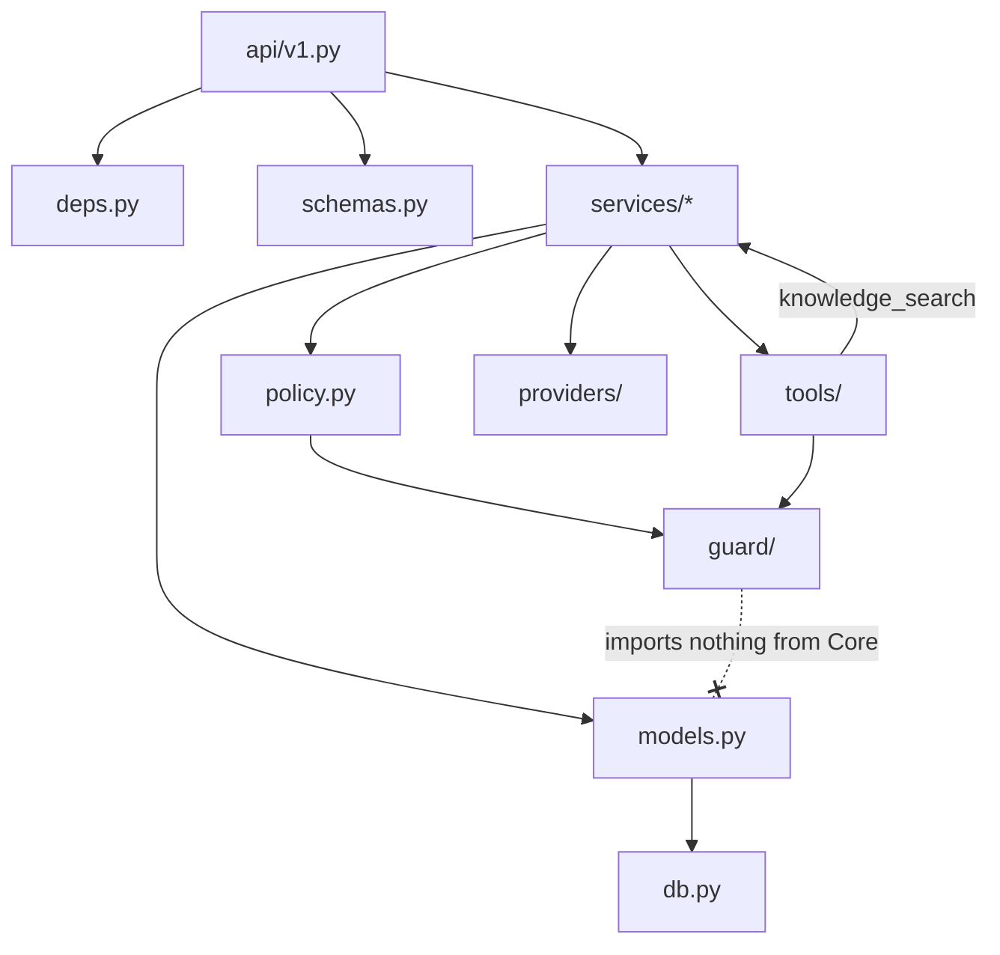

The guard is the only package with a hard rule: it imports **only the Python standard
library**. A test (`tests/test_guard.py`) fails if that ever changes. This is what lets a
future SDK, LiteLLM or MCP connector reuse the same rules without pulling in the web app or
the database.

---

## 3. Startup

What happens when you run `x0r serve`:

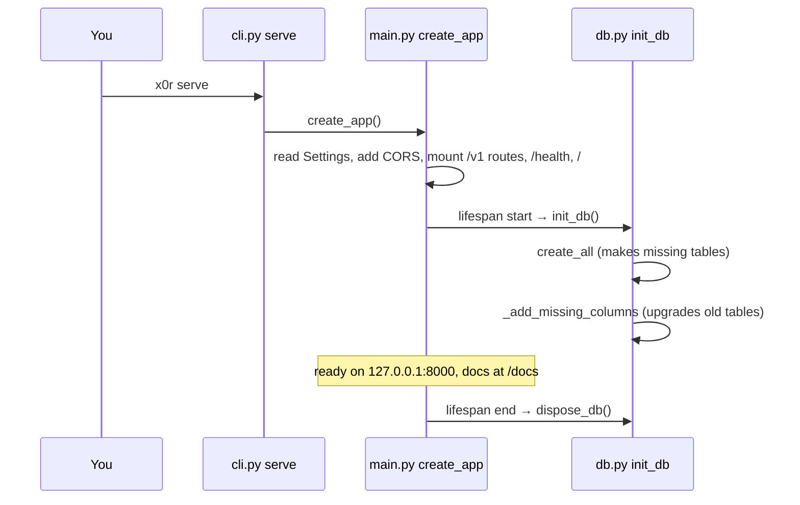

- **`create_all`** creates any table that doesn't exist yet. It never changes an existing one.
- **`_add_missing_columns`** covers that gap. Columns added after a table first shipped are
  listed in `_ADDED_COLUMNS`, and startup adds them in place (`ALTER TABLE ... ADD COLUMN`),
  plus their indexes. It is safe to run twice, and safe if two servers start at once.
- There is **no migration tool** (no Alembic). For a new nullable column, add it to the model
  and to `_ADDED_COLUMNS`. Anything bigger needs a real migration plan.

---

## 4. A request and its API key

### The key

```
x0r_1a2b3c4d_<43 random characters>
 │      │              │
 │      │              └─ the secret
 │      └─ prefix: 8 hex characters, stored in plain text for fast lookup
 └─ always "x0r"
```

`security.generate_key()` makes it. The database stores only the **SHA-256 hash** of the
whole key, never the key itself. The key is shown once, at creation.

### What happens on every request

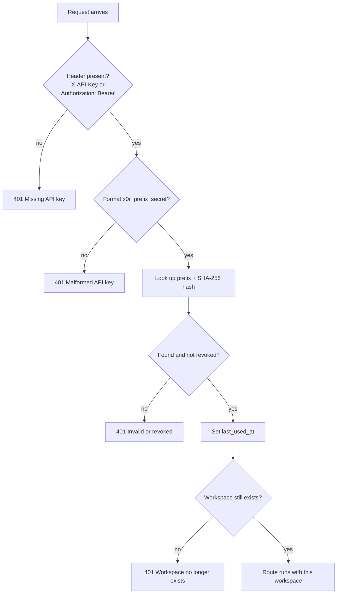

This lives in `deps.py` as two FastAPI dependencies: `get_api_key()` and `get_workspace()`.
Every route that takes `WorkspaceDep` gets the checked workspace, and then filters every
query by `workspace.id`.

### Creating a workspace

`POST /v1/workspaces` is the only route without an API key. It needs the **bootstrap token**
instead (`X-Bootstrap-Token` header, compared in constant time). If `X0R_BOOTSTRAP_TOKEN` is
not set, the route is turned off (403). The CLI (`x0r init`) creates workspaces directly and
doesn't need the token.

### How a route is built

Every route follows the same short pattern:

1. FastAPI checks the body against a `schemas.py` class. Too long or the wrong type means
   `422`.
2. The route calls one service function.
3. The route commits the session and returns.

Routes hold almost no logic, so to understand a feature you read its service.

---

## 5. Documents: ingest and chunking

`POST /v1/documents` (JSON) or `POST /v1/documents/upload` (a UTF-8 text file, up to 5 MB by
default) both end in `services/ingest.ingest_document()`.

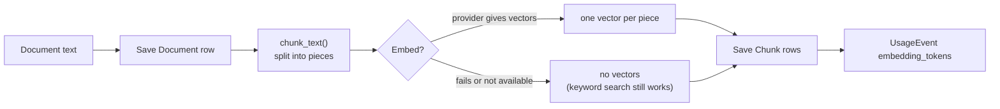

### How `chunk_text()` splits text

The target is about **900 characters per piece**, with **140 characters of overlap**.

1. Split on blank lines into paragraphs.
2. Add paragraphs to the current piece while it stays under 900 characters.
3. When the next paragraph doesn't fit, close the piece. The new piece starts with the
   **last 140 characters of the previous one**, so a sentence cut at the edge still appears
   whole somewhere.
4. A giant paragraph (over 2,700 characters) is cut into flat 900-character slices.
5. If the last piece is tiny (under 225 characters), it is merged into the one before.

Token counts here are estimates: `approx_tokens()` is characters ÷ 4.

Embedding is **best effort**. If the provider fails or returns the wrong number of vectors,
the document is still saved without vectors.

---

## 6. Search

`POST /v1/search`, and the `knowledge_search` tool, both call `services/retrieval.search()`.

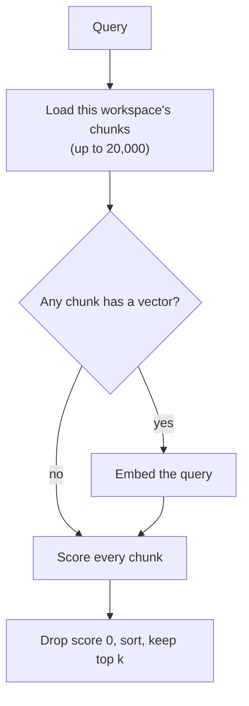

**The score for each chunk:**

- With vectors: `0.65 × vector similarity + 0.35 × keyword score`
- Without vectors: `keyword score` only

**The keyword score**, in plain words: for each query word found in the chunk, add more for
repeats, with diminishing returns (`tf / (tf + 1.2)`). Long chunks are slightly penalized, so
a short, focused chunk beats a long one with the same matches. The total is divided by the
number of distinct query words.

**Vector similarity** is cosine similarity. The mock provider builds vectors offline by
hashing words into 256 slots ("feature hashing"), so search works with no API key.

> **Know this:** search scans the chunks in Python. There is no vector index. That's fine for
> thousands of chunks, and slow for millions. A vector database (such as pgvector) would
> replace this one function.

---

## 7. The agent run loop

This is the heart of Core: `services/agents.run_agent()`, called by
`POST /v1/agents/{id}/run`.

### The body you send

```json
{
  "input": "Refund order A-1",
  "caller": { "subject": "user-42", "attributes": { "role": "support" } }
}
```

`caller` is optional. It says who the run acts for. Core trusts it because the API key
already proves which app is calling, so the app vouches for its own user. An attribute
value is a string or a list of strings.

Instead of `caller`, the body can carry `caller_token`: a caller signed with one of the
workspace's caller keys, for audience `x0r-core`. Core checks it before the run starts,
and a bad one is a `401` with the reason. See [CALLER-TOKENS.md](CALLER-TOKENS.md).

### The loop

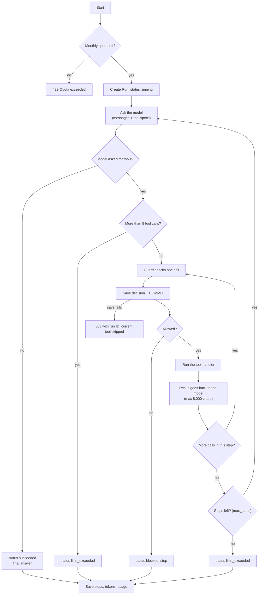

### What the loop keeps

- **`messages`**: the conversation in OpenAI chat format (system, user, assistant, tool). It
  is sent back to the model on every step.
- **`steps`**: the transcript saved on the `Run` row. Each step has a `type`:

| Step type | Written when | Main fields |
| --- | --- | --- |
| `model` | The model answered | `content`, `tool_calls` (id, name, arguments), `usage` |
| `policy` | The guard decided | `version`, `tool`, `tool_call_id`, `allowed`, `reason`, `caller_subject` (never the arguments) |
| `tool` | A tool ran | `tool`, `arguments`, `result` |
| `limit` | A limit stopped the run | `reason` or `max_steps` |
| `error` | Something crashed | `message` |

### How a run ends

| Status | Meaning | HTTP |
| --- | --- | --- |
| `succeeded` | The model gave a final answer | 200 |
| `blocked` | The guard denied a tool call. The tool did not run | 200 |
| `limit_exceeded` | Too many steps, or more than 8 tool calls in one step | 200 |
| `failed` | Something crashed (for example the provider) | 502 with `run_id` |
| (no run) | Monthly quota already used up | 429 |
| (current tool skipped) | The decision couldn't be saved | 503 with `run_id` |

`blocked` and `limit_exceeded` come back as **200**, so a client must read `status`.

### Why the commit happens mid-run

The decision is committed **before** the tool runs. If the server dies during the tool, the
record of what was allowed is already safe. The same commit saves the run as `running`
with its transcript and token totals so far. If the save fails, Core rolls back, skips the
current tool, and tries to preserve any newly completed steps for an existing run. Agent
and eval requests return `503` with the run ID. Earlier tools may already have run. If the first decision of a run fails, nothing was saved and `run_id` is null.

### Tool failures

A tool that raises an error doesn't crash the run. The error becomes the tool's result
(`{"error": "..."}`), and the model sees it and can try something else.

---

## 8. The guard

The guard answers one question: **may this agent run this tool call, with these arguments,
for this caller?**

### The objects

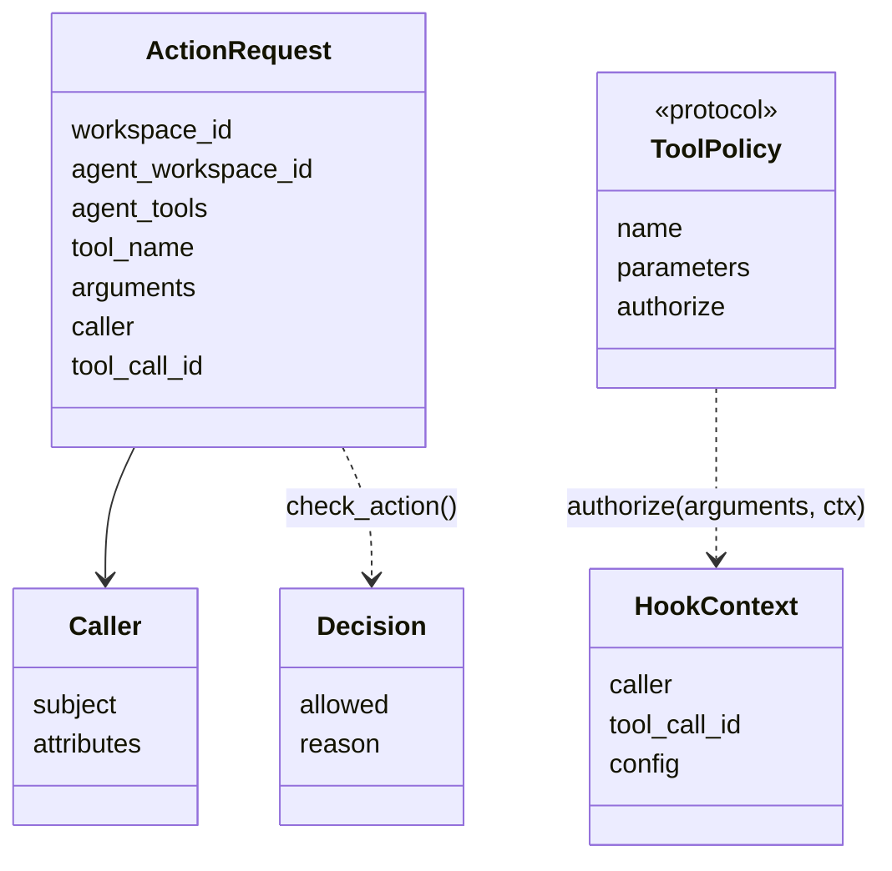

- `check_action(request, operator_tools=..., tools=..., config=...)` returns a `Decision`.
  The legacy keyword `context=` is an alias for `config=`. Passing both raises `TypeError`.
- `ToolPolicy` is only what the guard needs to know about a tool: its name, its argument
  schema and its optional rule (`authorize`). Core's `Tool` class fits it.
- `policy.authorize_tool()` is Core's adapter. It reads the operator allowlist from Settings,
  finds the tool registry, builds the `ActionRequest`, and passes Settings as `config`.

### The seven checks

They run in order, and the first "no" wins.

| # | Check | Denial reason |
| --- | --- | --- |
| 1 | The call comes from the agent's own workspace | `workspace_mismatch` |
| 2 | The agent's tool list includes the tool | `not_granted_to_agent` |
| 3 | The operator allowlist (`X0R_OPERATOR_TOOL_ALLOWLIST`) includes it | `not_granted_by_operator` |
| 4 | The arguments are a JSON object | `invalid_arguments` |
| 5 | The tool is registered, under its own name | `unknown_tool` |
| 6 | The arguments match the tool's schema | `invalid_arguments` / `unexpected_arguments` |
| 7 | The tool's own rule (`authorize` hook) says yes | the hook's reason, or `authorizer_error` if it crashes |

If all seven pass, the result is `Decision(True, "granted")`.

**Two grants, on purpose.** The agent's list (check 2) is set by whoever configures the
agent. The operator list (check 3) is set by whoever runs the server. Both must say yes. So a
workspace user can't give their agent `http_get` on their own.

**What check 6 enforces.** It covers a small, safe subset of JSON Schema:

- `type`: one of `string`, `integer`, `number` or `boolean`. A property with any other type
  or no type is denied.
- `required` fields must be present. A required string can't be blank.
- `minLength` / `maxLength` for strings. Every string is capped at 8,000 characters anyway.
- `minimum` / `maximum` for numbers. `NaN` and infinity are always denied.
- `enum` and `const`. `1` matches `1.0`, but `true` never matches `1`.
- `true` doesn't count as a number. Python thinks `True == 1`, and the guard doesn't.
- An argument the schema doesn't declare is denied (`unexpected_arguments`).
- That's an allowlist. A schema that uses any other keyword (`pattern`, `format`, `anyOf`,
  `$ref`, `minProperties`, ...), on a property or at the root, is denied. A constraint is
  never skipped without anyone noticing.

**Check 7 is where business rules go.** The hook gets the arguments and a `HookContext`
holding the caller. For example:

```python
def own_order_only(arguments, ctx):
    # The app sends: "caller": {"subject": "user-42", "attributes": {"orders": ["A-1", "A-7"]}}
    if ctx.caller is None:
        return "caller_required"
    owned = ctx.caller.attributes.get("orders", ())
    if isinstance(owned, str):
        owned = (owned,)   # one order sent as a plain string; never use `in` on a string
    if arguments["order_id"] not in owned:
        return "not_callers_record"
    return None   # None means allow
```

Hooks written the older way, `(arguments, settings)`, still work: `HookContext` passes any
unknown attribute through to Settings.

**Small traps the guard closes.**

- A grant list passed as a string (`"refund"` instead of `["refund"]`) is denied, because
  `"fund" in "refund"` would be true.
- A tool's rules stored under the wrong name are denied.

### The decision log

Each decision becomes a `policy_decisions` row:

- what is stored: tool, tool-call id, caller subject, allowed, reason and policy version
- what is never stored: the argument values, which may contain personal data

Read the log with `GET /v1/policy/decisions`. You can filter by `allowed`, `run_id` or
`tool_call_id`.

`POLICY_VERSION` is `"3"` (it went to 3 when `enum`, `const` and the keyword allowlist were added). If the meaning of a decision ever changes, the version goes up,
so old records stay understandable.


### The same guard outside Core: the SDK wrapper

`guard/sdk.py` puts the guard around any OpenAI-style client, with no server:

```python
client = wrap(OpenAI(), Policy(allow=["lookup_order"], on_decision=save))
```

On every `chat.completions.create()` or `.parse()` it sends the request, then runs
`check_action` on each tool call in the reply. Here "agent granted" means the tool was
offered in `tools=`, and "operator allows" means `Policy.allow`. Each decision goes to
`on_decision` before the reply is returned. Denied calls are removed from the reply, and in
raise mode `ToolCallDenied` is raised too. Client paths pass through only if they're on an
allowlist of paths that can't return tool calls. Everything else (streaming, the Responses
API, beta, raw HTTP and raw responses) is refused. Details are in [SDK.md](SDK.md).

---

## 9. Tools

A tool is a `Tool` object (`tools/base.py`):

| Field | Meaning |
| --- | --- |
| `name` | What the model calls it |
| `description` | What the model reads to decide when to use it |
| `parameters` | JSON schema of the arguments (the guard enforces it) |
| `handler` | `async def handler(ctx, **arguments)`, the code that runs |
| `authorize` | Optional rule, run as guard check 7 |

The handler gets a `ToolContext` with the database session, the `workspace_id` and Settings.
Tools look up data through `ctx.workspace_id`, so they stay inside the workspace.

### The three built-in tools

**`knowledge_search`** runs the search from section 6 inside the caller's workspace. `k` is
1 to 10.

**`calculator`** never uses Python's `eval`. It parses the expression into a syntax tree and
only accepts:

- numbers and `+ - * / // % **`
- the functions `sqrt`, `abs`, `round`, `min` and `max`

It also refuses:

- input over 4,096 characters or more than 256 tree nodes
- nesting deeper than 32
- an exponent above 64, or a base above 1,000,000 when raising to a power
- numbers above 10¹⁰⁰, and results that are not finite

**`http_get`** is off by default and has two layers of protection:

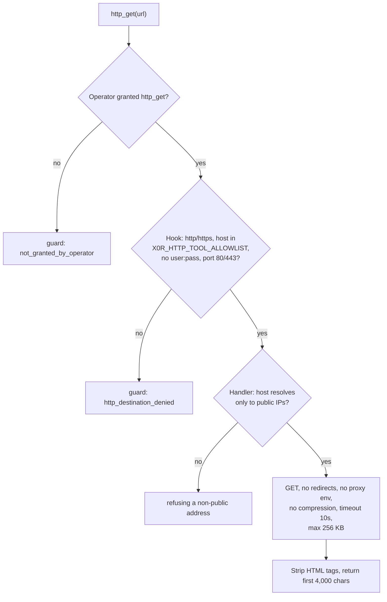

The guard layer stops the call before anything happens. The handler checks again, and adds
the network checks (public IPs only, size and time limits).

### Adding your own tool

See [`examples/custom_tool.py`](../examples/custom_tool.py). In short:

1. Create a `Tool` and put it in `REGISTRY`.
2. Add its name to `X0R_OPERATOR_TOOL_ALLOWLIST`.
3. Add its name to the agent's `tools`.

The schema checks run automatically. Your handler is trusted code, so it must still apply
its own business rules, or you put them in `authorize`.

---

## 10. Model providers

A provider is anything with two methods (`providers/base.py`):

- `complete(messages, tools, model, temperature, max_tokens)` returns a `Completion`: text,
  or a list of `ToolCall(id, name, arguments)`, plus `Usage(prompt_tokens, completion_tokens)`.
- `embed(texts)` returns one vector per text, or `None` if it can't.

`providers/registry.build_provider(name)` picks one by name. The default comes from
`X0R_PROVIDER`, and an agent can set its own.

| Provider | Names | How it works |
| --- | --- | --- |
| `MockProvider` | `mock` | Offline and predictable. Step 1: if `knowledge_search` is available, it asks for it with the user's question. Step 2: it answers by quoting the top two hits. Vectors come from word hashing. Used by tests and the demo |
| `OpenAICompatibleProvider` | `openai`, `openai_compatible` | Sends `POST {base_url}/chat/completions` and `/embeddings`. Works with OpenAI, OpenRouter, Groq, Together, vLLM, Ollama, LM Studio and Azure. Tool-call arguments that aren't valid JSON become `{"_raw": "..."}`, which the guard then denies |

To add a provider: subclass `Provider`, implement `complete` (and `embed` if you can), then
add it to `_REGISTRY`.

---

## 11. Usage and quota

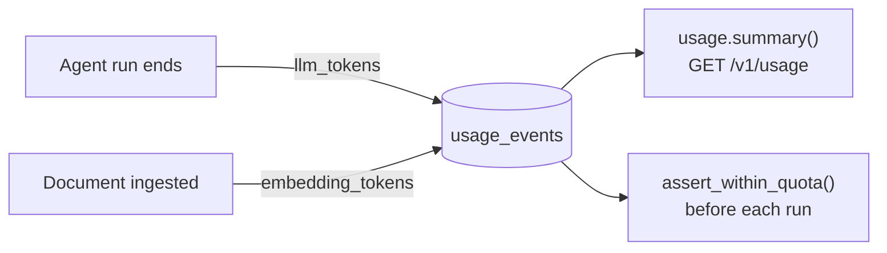

- Every run adds one `llm_tokens` event (prompt + completion tokens, as the provider reports
  them). Every ingest adds one `embedding_tokens` event.
- The month starts on the 1st at 00:00 UTC.
- Before a run, `assert_within_quota()` sums this month's `llm_tokens`. If the total is at or
  above `monthly_token_quota`, the run is refused with `429`.
- **The check happens only at the start.** A long run can go over the limit, and so can two
  runs started at once. It is a soft limit, not a hard budget.

---

## 12. Evals

An eval suite is a list of `(question, expected answer)` pairs for one agent.

`POST /v1/evals/{id}/run` (`services/evals.run_suite()`) does this for every case:

1. It runs the agent with the question, so the guard, the limits and metering all apply.
2. It scores the answer with `similarity()`: the share of the expected answer's words that
   appear in the real answer (recall). For example, expected "24 months" and an answer
   containing both words scores 1.0.
3. A case passes only if the run `succeeded` **and** the score is at least the threshold
   (default 0.45). Blocked or failed runs always score 0.

The scoring is deliberately simple and repeatable. An AI judge could replace `similarity()`
later without changing anything around it.

---

## 13. The database

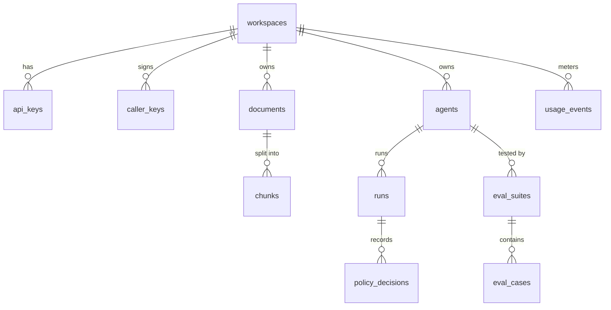

| Table | Key columns | Notes |
| --- | --- | --- |
| `workspaces` | `id` (`ws_…`), `name`, `plan`, `monthly_token_quota` | The tenant. Everything else points here |
| `api_keys` | `prefix`, `key_hash` (unique), `last_used_at`, `revoked_at` | Hash only, never the key |
| `caller_keys` | `id` (`ck_…`), `name`, `secret`, `revoked_at` | Signs caller tokens. The root secret never leaves Core; proxies get per-audience verify keys |
| `documents` | `title`, `source`, `mime`, `content`, `meta` (JSON) | Full original text |
| `chunks` | `document_id`, `ordinal`, `content`, `tokens`, `embedding` (JSON list) | Deleted with their document |
| `agents` | `system_prompt`, `provider`, `model`, `tools` (JSON list), `temperature`, `max_steps` (default 6) | |
| `runs` | `status`, `input`, `output`, `steps` (JSON), `error`, token counts, `latency_ms` | The transcript holds raw content |
| `policy_decisions` | `run_id`, `agent_id`, `tool`, `tool_call_id`, `caller_subject`, `allowed`, `reason`, `policy_version` | Append-only, saved before the tool. No arguments |
| `usage_events` | `kind`, `quantity`, `meta` | Append-only meter |
| `eval_suites` / `eval_cases` | `input`, `expected`, `last_output`, `score`, `passed` | |

IDs are a short prefix plus random hex (`ws_`, `key_`, `doc_`, `chk_`, `agt_`, `run_`,
`evs_`, `evc_`), so you can tell what an ID is just by looking at it. Decisions and usage
events use auto-increment integers.

### When things are committed

| Action | Commits |
| --- | --- |
| Most routes | Once, at the end of the route |
| Agent run | Once **per tool decision** (before the tool), then once at the end |
| Failed run (502) | Committed anyway, so you can inspect it |
| Quota hit (429) on a single run | Rolled back: nothing was done yet |
| Quota hit during an eval | Earlier cases are committed, because they used real tokens |

### SQLite vs Postgres

SQLite is the default (`./x0r.db`) and needs nothing installed. For real use, set
`X0R_DATABASE_URL=postgresql+asyncpg://…`. The code is the same for both. Everything is
async (`AsyncSession`), and objects stay readable after a commit (`expire_on_commit=False`).

---

## 14. Settings

All settings are environment variables with the prefix `X0R_` (a `.env` file works too).
They are defined in `config.py`.

| Variable | Default | What it controls |
| --- | --- | --- |
| `X0R_DATABASE_URL` | `sqlite+aiosqlite:///./x0r.db` | Which database |
| `X0R_PROVIDER` | `mock` | Default model provider |
| `X0R_OPENAI_BASE_URL` / `X0R_OPENAI_API_KEY` | OpenAI / empty | Where the OpenAI-style provider sends calls |
| `X0R_CHAT_MODEL` / `X0R_EMBEDDING_MODEL` | `gpt-4o-mini` / `text-embedding-3-small` | Default models |
| `X0R_OPERATOR_TOOL_ALLOWLIST` | `knowledge_search,calculator` | Guard check 3 |
| `X0R_HTTP_TOOL_ALLOWLIST` | empty (HTTP off) | Hosts `http_get` may reach |
| `X0R_MAX_TOOL_CALLS_PER_STEP` | 8 (1–32) | Tool calls allowed in one model reply |
| `X0R_MAX_UPLOAD_BYTES` | 5 MB | Upload size limit |
| `X0R_MAX_HTTP_RESPONSE_BYTES` / `X0R_HTTP_TOOL_TIMEOUT` | 256 KB / 10 s | `http_get` limits |
| `X0R_BOOTSTRAP_TOKEN` | empty (off) | Allows `POST /v1/workspaces` |
| `X0R_CORS_ORIGINS` | `*` | Browsers allowed to call the API |
| `X0R_REQUEST_TIMEOUT` | 60 s | Provider HTTP timeout |

---

## 15. Limits and weak spots

These are the honest edges of the system. Know them before you promise anything to a
customer.

| Area | What to know | Way forward |
| --- | --- | --- |
| Caller identity | The app vouches for its user, and Core can't verify it. Not signed yet | Signed identity with the proxy connectors (plan phase 4) |
| Access control | Workspace isolation plus tool grants. There are no user roles inside a workspace (no RBAC) | Per-workspace policy (plan phase 4) |
| Transcripts | `runs.steps` keeps raw inputs, tool arguments and results, which may hold personal data. No redaction or retention rules yet | Redaction and retention controls |
| Decision log | Ordinary database rows. Someone with database access could edit them | Tamper-evident log (plan phase 4) |
| Quota | Checked only when a run starts, so it can be overshot | Reserve tokens up front |
| `http_get` | The public-IP check and the real connection resolve DNS separately, so a DNS rebinding trick is possible in theory. Keep the host allowlist short | Pin the resolved IP for the connection |
| Search | Scans every chunk in Python, with no vector index | pgvector or another vector store |
| Schema | No migration tool. Only new nullable columns are handled | Alembic when the schema starts changing more |
| Security evidence | The demo uses the mock provider. It proves the wiring, not how a real model behaves | Tests against real models per customer |
| CORS | `*` by default, which is fine for a local demo | Set real origins in production |

---

## 16. Where to change what

| I want to… | Go to |
| --- | --- |
| Add an API route | `api/v1.py`, plus shapes in `schemas.py` |
| Change the agent loop | `services/agents.run_agent()` |
| Add or change a guard rule for everyone | `guard/engine.check_action()`. Bump `POLICY_VERSION` if outcomes change |
| Add a rule for one tool | That tool's `authorize=` hook |
| Add a tool | `tools/builtin.py`, or your own file like `examples/custom_tool.py` |
| Add a model provider | `providers/`, plus `_REGISTRY` in `providers/registry.py` |
| Change how documents are split | `services/chunking.chunk_text()` |
| Change search scoring | `services/retrieval.search()` / `_keyword_score()` |
| Add a column | `models.py`, plus `_ADDED_COLUMNS` in `db.py` if old databases need it |
| Add a setting | `config.Settings` (it becomes `X0R_<NAME>`) |
| Change eval scoring | `services/evals.similarity()` |

Run `pytest -q` and `x0r security-demo` after any change. The demo output must still match
[`security-demo.expected.json`](security-demo.expected.json).
