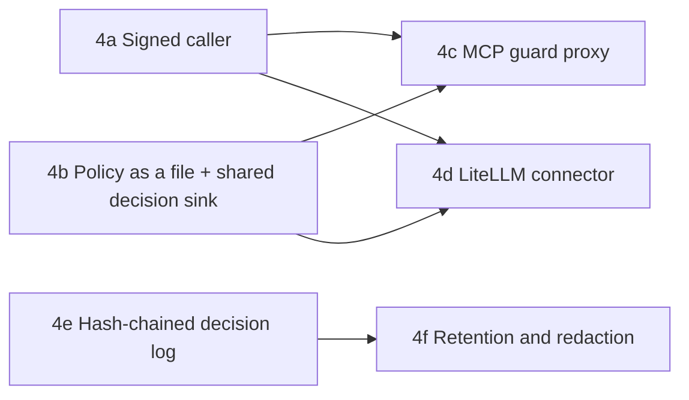
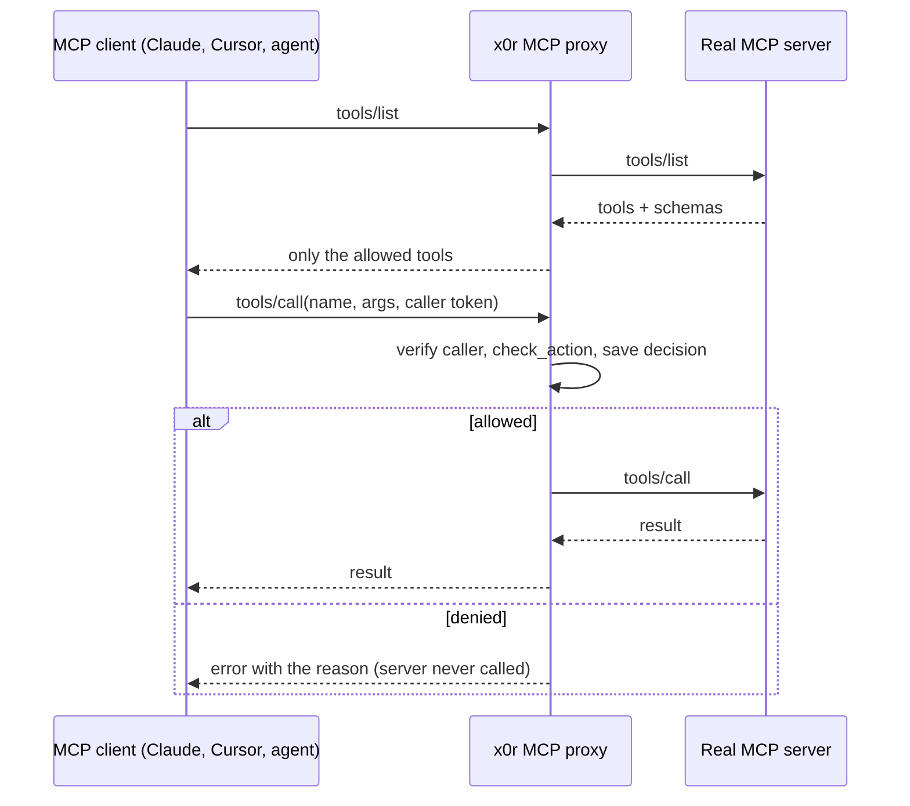

# Phase 4 plan: connectors, shared policy, trustworthy log

Status: plan, nothing here is built yet. It breaks the phase 4 row of
[GATEWAY-PLAN.md](GATEWAY-PLAN.md) into pieces that each land as their own pull request.

## Where we are

Today the guard runs in two places: inside Core's agent loop, and inside your own app
through `wrap()`. Both use the same `check_action`. Three things are missing before an
SMB, SaaS team or agency can put it in front of agents they already run:

1. **It can't sit where their agents already are.** Many use MCP tool servers (Claude,
   Cursor, agent frameworks) or route model calls through LiteLLM.
2. **Policy is Python code.** An agency can't hand a client a rule file, and Core and the
   SDK can't share one.
3. **The log is a plain table.** Anyone with database access can edit or delete a row and
   nobody can tell.

## The pieces, in order



| # | Piece | Why it comes here | Size |
| --- | --- | --- | --- |
| 4a | Signed caller identity | Every connector crosses a hop. The caller must arrive in a form a proxy can trust | S |
| 4b | Policy as a file, decision sink | One policy for Core, SDK and connectors, and one place to see every decision | M |
| 4c | MCP guard proxy | Checks at the moment a tool actually runs. Works with any MCP client | M |
| 4d | LiteLLM connector | For teams that already route through LiteLLM | S |
| 4e | Hash-chained decision log | Makes edits and deletions detectable | S |
| 4f | Retention and redaction | What buyers ask about once the log holds real data | S |

4a and 4b come first because both connectors need them. 4e and 4f don't depend on the
connectors and can run in parallel with them.

### 4a. Signed caller identity

Today the caller is trusted because the app passes it in-process (SDK) or the API key
vouches for it (Core). Through a proxy, nothing vouches for it, so it gets signed.

- The app signs a small token, `x0r.v1.<payload>.<sig>`. The payload is base64url JSON:
  `{sub, attrs, aud, iat, exp}`, and the signature is HMAC-SHA256 with a per-workspace
  secret. That's standard library only, so the guard boundary holds.
- `x0r_core.guard.identity`: `sign_caller(caller, secret, audience, ttl)` and
  `verify_caller(token, secrets, audience) -> Caller`. Several active secrets are
  accepted, so keys can rotate.
- New reason codes: `caller_signature_invalid`, `caller_expired`, `caller_wrong_audience`.
  A bad token denies the call. It never falls back to "no caller".
- Core: `POST /v1/caller-tokens` mints a token for an API key's workspace, and run
  requests accept `caller_token` next to `caller`.
- Short lifetimes (5 minutes by default) and no revocation list in this phase.

Done when: tokens round-trip, tampered, expired or wrong-audience tokens are denied with
their reason, rotation works, and the guard still imports only the standard library.

### 4b. Policy as a file, and a shared decision sink

A policy file that Core, `wrap()` and both connectors load the same way. It's TOML, so
`tomllib` from the standard library reads it.

```toml
version = 1
allow = ["lookup_order", "refund_order"]

[rules.refund_order]
caller_owns = { argument = "order_id", attribute = "orders" }
max = { argument = "amount", value = 50 }

[rules.lookup_order]
caller_owns = { argument = "order_id", attribute = "orders" }
```

- Built-in rule types only: `caller_owns`, `max` / `min`, `one_of`, `caller_has`
  (attribute equals a value), `deny`. They compile to the same hooks people write in
  Python today, and Python rules still work for anything else.
- An unknown key or rule type fails at load time. It never becomes "allow".
- `Policy.from_file(path)` for the SDK. Core gains a `workspace_policies` table, with
  `PUT /v1/policy` to upload a file and a stored revision number.
- Every decision records `policy_revision` next to `policy_version`, so you can tell
  which file made it.
- Decision sink: `core_sink(url, api_key)` is an `on_decision` that posts to a new
  `POST /v1/policy/decisions`. Then SDK and connector decisions land in the same log as
  Core's. Retry and fail-closed rules match the in-process ones.

Done when: the same file gives the same decisions in Core, `wrap()` and a connector
(one shared test table), bad files are rejected with a clear message, and decisions from
the sink show up in `GET /v1/policy/decisions`.

### 4c. MCP guard proxy

The strongest place to check is where the tool actually runs. MCP gives us that: every
action is a `tools/call` request to a tool server.



- `x0r mcp-proxy --policy policy.toml -- <server command>` for stdio servers, and
  `--upstream <url>` for HTTP servers.
- Schemas come from the real server's `tools/list`, so check 6 uses the schema the
  server actually enforces.
- The caller comes from a signed token (4a), sent in request metadata over HTTP or as an
  environment variable for a stdio session.
- Unknown methods that can cause actions are refused. Resources and prompts are passed
  through read-only, with a flag to block them.
- It lives in `x0r_core.connectors.mcp` behind an `x0r-core[mcp]` extra. The guard
  package itself never imports `mcp`.

Done when: a denied call never reaches the server (proven with a test server that
records calls), `tools/list` hides tools the policy doesn't allow, it works with stdio
and HTTP, and there's an example config for Claude Desktop.

### 4d. LiteLLM connector

- A LiteLLM custom guardrail class. After the model answers, it checks the tool calls
  in the reply, the same way `wrap()` does: remove or raise.
- The caller comes from a signed header (4a), and the policy from a file (4b).
- Streaming requests are refused, as in the SDK, until streaming is supported.
- `x0r_core.connectors.litellm`, behind an `x0r-core[litellm]` extra. We never fork
  LiteLLM. If its hook API changes, only this module changes.
- Pinned to the LiteLLM versions we test, with a CI job for each.

Done when: a LiteLLM proxy config with our guardrail blocks a denied call end to end,
and decisions reach the sink.

### 4e. Hash-chained decision log

- New columns: `prev_hash` and `row_hash`, where
  `row_hash = sha256(prev_hash + canonical JSON of the row)`. There is one chain per
  workspace, and each insert happens under the same lock Core already takes.
- `x0r verify-log [--workspace ws_...]` walks the chain and reports the first broken row.
- `GET /v1/policy/decisions/head` returns the latest hash. A customer can store it
  elsewhere, so even a rewrite of the whole chain shows.
- Existing rows get a starting hash during migration.

Done when: changing, deleting or reordering any row makes `verify-log` fail at that row,
and concurrent inserts still produce one valid chain.

### 4f. Retention and redaction

- Per-workspace retention in days. A purge job deletes old rows, then records a
  checkpoint (the last deleted hash), so the chain still verifies.
- Redaction options: store `caller_subject` hashed (with a workspace salt) instead of
  plain, and drop custom reason text that could carry data.
- Argument values are still never stored. That doesn't change.

Done when: the purge keeps `verify-log` passing, and hashed subjects still let you find
"all decisions for user X" when you know X.

## Constraints

The rules from GATEWAY-PLAN.md still hold. In addition:

- A decision change bumps `POLICY_VERSION`. A policy file change bumps only
  `policy_revision`.
- Each connector fails closed. If it can't check something, it refuses it.
- Connectors are extras. A plain `pip install x0r-core` gets no new dependencies.
- `x0r security-demo` gets a connector scenario once 4c lands.

## Decisions to make before building

1. **Which connector first: MCP or LiteLLM?** I suggest MCP. It checks at the moment
   the tool runs, it works with tools SMBs and agencies already use, and it doesn't need
   them to adopt a gateway.
2. **Proxy shape for MCP.** A local process (stdio, zero hosting) first, with hosted HTTP
   after? I suggest yes.
3. **Policy file format.** TOML (standard library, no new dependency) or YAML (more
   familiar, needs PyYAML in the loader)? I suggest TOML.
4. **First customer.** If a pilot is lined up, its stack decides 1 and 3.
