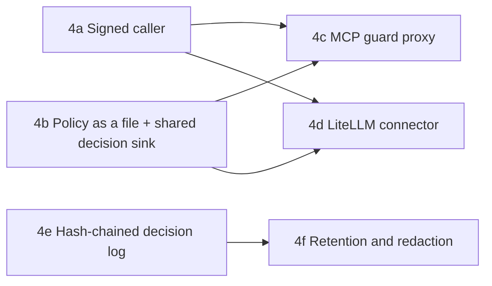
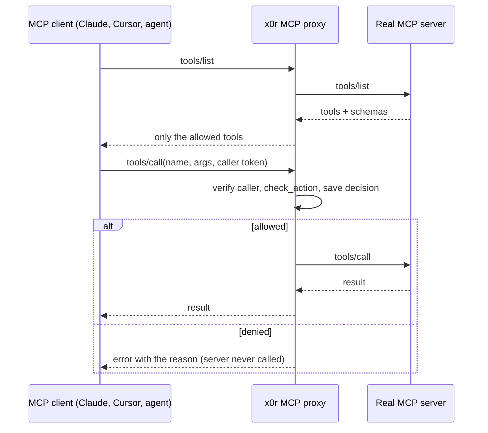

# Phase 4 plan: connectors, shared policy, trustworthy log

Status: in progress. 4a is implemented ([CALLER-TOKENS.md](CALLER-TOKENS.md)); the rest is planned. It breaks the phase 4 row of
[GATEWAY-PLAN.md](GATEWAY-PLAN.md) into pieces that each land as their own pull request.

## Where we are

Today the guard runs in two places: inside Core's agent loop, and inside your own app
through `wrap()`. Both use the same `check_action`. Three things are missing before an
SMB, SaaS team or agency can put it in front of agents they already run:

1. **It can't sit where their agents already are.** Many use MCP tool servers (Claude,
   Cursor, agent frameworks) or route model calls through LiteLLM.
2. **Policy is Python code.** An agency can't hand a client a rule file, and Core and the
   SDK can't share one.
3. **The log is a plain table.** Anyone with database access can edit or delete a row and
   nobody can tell.

## The pieces, in order



| # | Piece | Why it comes here | Size |
| --- | --- | --- | --- |
| 4a | Signed caller identity | Every connector crosses a hop. The caller must arrive in a form a proxy can trust | S |
| 4b | Policy as a file, decision sink | One policy for Core, SDK and connectors, and one place to see every decision | M |
| 4c | MCP guard proxy | Checks at the moment a tool actually runs. Works with any MCP client | M |
| 4d | LiteLLM connector | For teams that already route through LiteLLM | S |
| 4e | Hash-chained decision log | Makes edits and deletions detectable | S |
| 4f | Retention and redaction | What buyers ask about once the log holds real data | S |

4a and 4b come first because both connectors need them. 4e and 4f don't depend on the
connectors and can run in parallel with them.

### 4a. Signed caller identity (implemented)

Today the caller is trusted because the app passes it in-process (SDK) or the API key
vouches for it (Core). Through a proxy, nothing vouches for it, so it gets signed.

- The app signs a small token, `x0r.v1.<payload>.<sig>`. The payload is base64url JSON:
  `{kid, sub, attrs, aud, iat, exp}`, and the signature is HMAC-SHA256 with a per-workspace
  secret. That's standard library only, so the guard boundary holds.
- `x0r_guard.identity`: `sign_caller(caller, key_id=, secret=, audience=, ttl=)` and
  `verify_caller(token, keys=, audience=) -> Caller`. `keys` maps key ids to secrets, so
  several can be active while keys rotate.
- New reason codes: `caller_signature_invalid`, `caller_expired`, `caller_wrong_audience`,
  `caller_token_malformed`.
  A bad token denies the call. It never falls back to "no caller".
- Core: `POST /v1/caller-keys` (create; secrets are derived from a server secret, never
  stored), `/activate` to switch the signing key, `/verifier` for a per-audience verify
  key, `GET` and `DELETE` to
  list and revoke, and `POST /v1/caller-tokens` to mint with the newest key. Run requests
  accept `caller_token` instead of `caller`, for audience `x0r-core`.
- Short lifetimes (5 minutes by default) and no revocation list in this phase.
- Attribute values may be a string or a list of strings, so "owns orders A-1 and A-2" is
  `{"orders": ["A-1", "A-2"]}`. `Caller.attributes` widens to `str | tuple[str, ...]`.
  A list is matched by exact membership, and a string is never split on commas.

Done when: tokens round-trip, tampered, expired or wrong-audience tokens are denied with
their reason, rotation works, and the guard still imports only the standard library.

### 4b. Policy as a file, and a shared decision sink

A policy file that Core, `wrap()` and both connectors load the same way. It's TOML, so
`tomllib` from the standard library reads it.

```toml
version = 1
allow = ["lookup_order", "refund_order"]

[rules.refund_order]
caller_owns = { argument = "order_id", attribute = "orders" }
max = { argument = "amount", value = 50 }

[rules.lookup_order]
caller_owns = { argument = "order_id", attribute = "orders" }
```

- Built-in rule types only: `caller_owns`, `max` / `min`, `one_of`, `caller_has`
  (attribute equals a value), `deny`. They compile to the same hooks people write in
  Python today, and Python rules still work for anything else.
- An unknown key or rule type fails at load time. It never becomes "allow".
- `Policy.from_file(path)` for the SDK. Core gains a `workspace_policies` table, with
  `PUT /v1/policy` to upload a file and a stored revision number.
- Every decision records which policy made it: `policy_digest` (SHA-256 of the file's
  bytes, always set) and `policy_revision` (Core's number for an uploaded file, empty for
  a local file Core has never seen). Both appear in `GET /v1/policy/decisions`.
- A run loads the policy and its revision once, as one snapshot, and carries it through
  every decision in that run. An upload during a run doesn't change what the run uses
  or what its decisions say.
- Decision sink: `core_sink(url, api_key)` is an `on_decision` that posts to a new
  `POST /v1/policy/decisions`. Then SDK and connector decisions land in the same log as
  Core's. Each record carries an idempotency key (a UUID made when the decision is made,
  so retries reuse it), with a unique index on it, so a retry never adds a second row.
  The record also carries `policy_digest`, which Core maps to a revision when it knows
  the file. Fail-closed rules match the in-process ones.

Done when: the same file gives the same decisions in Core, `wrap()` and a connector
(one shared test table), bad files are rejected with a clear message, decisions from
the sink show up in `GET /v1/policy/decisions` once each, even when retried, and each
decision names the exact policy that made it.

### 4c. MCP guard proxy

The strongest place to check is where the tool actually runs. MCP gives us that: every
action is a `tools/call` request to a tool server.



- `x0r mcp-proxy --policy policy.toml -- <server command>` for stdio servers, and
  `--upstream <url>` for HTTP servers.
- Schemas come from the real server's `tools/list`, so check 6 uses the schema the
  server actually enforces.
- MCP tools often use arrays, nested objects and `$ref`, which the guard denies today.
  4c widens the schema subset (arrays with `items`, `minItems`/`maxItems`, nested
  objects to a fixed depth, local `$ref`). Anything still unsupported stays denied.
  `x0r mcp-proxy --check` lists every tool whose schema the guard can't fully check, so
  this shows up at setup time, not in production. An operator can set
  `schema = "skip"` on one tool in the policy file to check only the grants and rules
  for it, and each such decision is logged with that fact.
- Retries: the proxy never retries a call itself. If the client sends an idempotency key
  in the call's `_meta`, the proxy keeps the result for a short window and replays it
  for a repeated key instead of calling the server twice. Without a key, a client that
  retries after a lost response can run a tool twice, as with any MCP server. The docs say
  so, and recommend idempotent tools for anything that moves money or data.
- The caller comes from a signed token (4a). Over HTTP it's sent with each request.
  For stdio, the proxy reads it from `--caller-token-file`, again before each call, so the
  app can write a fresh token before the old one expires and a long session keeps
  working. The proxy never passes the token, its file path or any `X0R_*` variable to the
  server it starts: the child gets a cleaned environment, so it can't read and replay
  the token.
- Unknown methods that can cause actions are refused. Resources and prompts are passed
  through read-only, with a flag to block them.
- It lives in `x0r_core.connectors.mcp` behind an `x0r-core[mcp]` extra. The guard
  package itself never imports `mcp`.

Done when: a denied call never reaches the server (proven with a test server that
records calls), `tools/list` hides tools the policy doesn't allow, it works with stdio
and HTTP, the child process can't see the caller token, a repeated idempotency key runs
the tool once, and there's an example config for Claude Desktop.

### 4d. LiteLLM connector

- A LiteLLM custom guardrail class. After the model answers, it checks the tool calls
  in the reply, the same way `wrap()` does: remove or raise.
- The caller comes from a signed header (4a), and the policy from a file (4b).
- Streaming requests are refused, as in the SDK, until streaming is supported.
- `x0r_core.connectors.litellm`, behind an `x0r-core[litellm]` extra. We never fork
  LiteLLM. If its hook API changes, only this module changes.
- Pinned to the LiteLLM versions we test, with a CI job for each.

Done when: a LiteLLM proxy config with our guardrail blocks a denied call end to end,
and decisions reach the sink.

### 4e. Hash-chained decision log

- New columns: `prev_hash` and `row_hash`, where
  `row_hash = sha256(prev_hash + canonical JSON of the row)`. There is one chain per
  workspace.
- Every decision insert, from every writer, first takes a per-workspace lock in the same
  transaction: `pg_advisory_xact_lock` on the workspace on Postgres, and the database's
  single writer on SQLite. It then reads the head and appends. Two writers can't both
  extend the same head, so the chain never forks. (The lock Core takes today is only
  for schema setup. This adds a new one.)
- **Anchors.** A chain alone can't catch two things: the newest rows being deleted, or
  someone with database access recomputing every hash after an edit. So Core
  periodically writes an anchor: the head hash, row count and time, signed with a
  server key kept outside the database. It can also push each anchor to a place the
  customer controls (a webhook or a bucket).
- `x0r verify-log [--workspace ws_...] [--anchor file]` walks the chain and checks it
  against the latest anchor, or one you give it. It reports the first broken row, or
  "rows missing after the anchor".
- Honest claim: this detects edits and deletions by anyone who doesn't also have the
  anchor key and access to the anchors stored elsewhere. It isn't proof against someone
  who controls both.
- Rollout: the columns start nullable, and rows written before the upgrade stay
  unchained. The chain starts at the first hashed row, recorded as a "genesis" anchor.
  Core runs as one service, so an upgrade replaces every writer at once. If several
  versions ever run side by side, chaining is switched on only after every writer is
  upgraded. `verify-log` reports any unhashed row after the genesis anchor as a break.

Done when: changing, deleting or reordering any row, deleting the newest rows, or
rewriting the whole chain without the anchor key makes `verify-log` fail, and
concurrent inserts from several workers still produce one valid chain.

### 4f. Retention and redaction

- Per-workspace retention in days. In one transaction, the purge deletes old rows and
  writes a signed checkpoint anchor (the last deleted hash), so either both happen or
  neither does, and the chain still verifies from the checkpoint.
- Retention and redaction cover run history too: `runs.input`, `runs.output` and
  `runs.steps` hold prompts, results and tool arguments, so they're purged or redacted on
  the same schedule as the decisions they belong to.
- Redaction options: store `caller_subject` hashed (with a workspace salt) instead of
  plain, and drop custom reason text that could carry data.
- Argument values are still never stored in the decision log. That doesn't change.

Done when: the purge keeps `verify-log` passing even if it's interrupted, no run history
older than the retention period remains, and hashed subjects still let you find "all
decisions for user X" when you know X.

## Constraints

The rules from GATEWAY-PLAN.md still hold. In addition:

- A decision change bumps `POLICY_VERSION`. A policy file change bumps only
  `policy_revision`.
- Each connector fails closed. If it can't check something, it refuses it.
- Connectors are extras. A plain `pip install x0r-core` gets only `x0r-guard` added
  (standard library only), and no connector dependencies.
- `x0r security-demo` gets a connector scenario once 4c lands.

## Decisions

Made on 2026-11-27:

1. **MCP before LiteLLM.** 4c comes before 4d.
2. **A local stdio proxy first**, with hosted HTTP after.
3. **TOML** for the policy file, read with `tomllib` from the standard library.

Still open: if a pilot customer is lined up, their stack can change the order of the
pieces after 4c.
