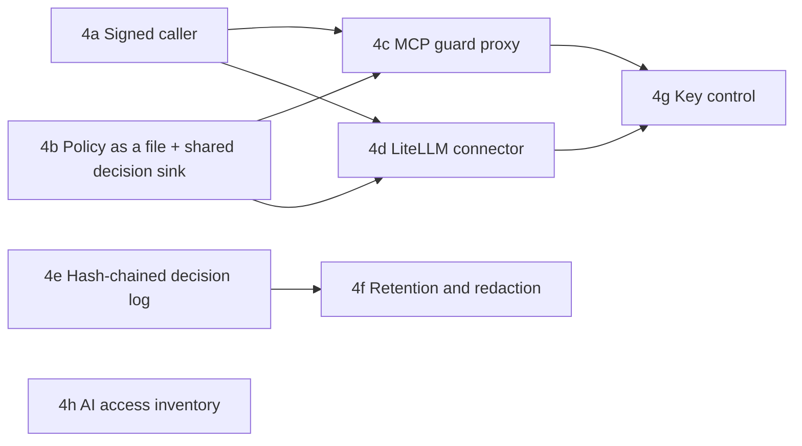

# Phase 4 plan: connectors, shared policy, trustworthy log

4a through 4d are done. 4e through 4h are planned. This plan breaks
phase 4 of [GATEWAY-PLAN.md](GATEWAY-PLAN.md) into pieces that can land as separate pull
requests.

## Where we are

The guard runs inside Core's agent loop and inside your app through `wrap()`. Both
use the same checks and can share a TOML policy and decision log. Signed caller
tokens are ready for the connectors. The next steps are to check calls from MCP and
LiteLLM, make edits to the decision log detectable, and give admins control over keys
and visibility into app access.

## The pieces, in order



| # | Piece | Why it comes here | Size |
| --- | --- | --- | --- |
| 4a (done) | Signed caller identity | Every connector crosses a hop. The caller must arrive in a form a proxy can trust | S |
| 4b (done) | Policy as a file, decision sink | One policy for Core, SDK and connectors, and one place to see every decision | M |
| 4c (done) | MCP guard proxy | Checks at the moment a tool actually runs. Works with any MCP client | M |
| 4d | LiteLLM connector (done) | For teams that already route through LiteLLM | S |
| 4e | Hash-chained decision log | Makes edits and deletions detectable | S |
| 4f | Retention and redaction | What buyers ask about once the log holds real data | S |
| 4g | Key control | Uses the LiteLLM gateway and MCP proxy to check calls from managed devices | M |
| 4h | AI access inventory | Shows which AI apps can reach company data and lets admins revoke access | L |

4a and 4b come first because both connectors need them. 4e and 4f don't depend on the
connectors and can run in parallel with them.

### 4a. Signed caller identity (implemented)

The SDK trusts the caller passed by the app. In Core, the workspace key holder can
assert the caller or send a signed token. Connectors use signed tokens to verify callers
across a network hop. See [Caller tokens](CALLER-TOKENS.md).

- The app signs a small token, `x0r.v1.<payload>.<sig>`. The payload is base64url JSON:
  `{kid, sub, attrs, aud, iat, exp}`, and the signature is HMAC-SHA256 with a per-workspace
  secret. That's standard library only, so the guard boundary holds.
- `x0r_guard.identity`: `sign_caller(caller, key_id=, secret=, audience=, ttl=)` and
  `verify_caller(token, keys=, audience=) -> Caller`. `keys` maps key ids to secrets, so
  several can be active while keys rotate.
- New reason codes: `caller_signature_invalid`, `caller_expired`, `caller_wrong_audience`,
  `caller_token_malformed`.
  A bad token denies the call. It never falls back to "no caller".
- Core: `POST /v1/caller-keys` (create; secrets are derived from a server secret, never
  stored), `/activate` to switch the signing key, `/verifier` for a per-audience verify
  key, `GET` and `DELETE` to
  list and revoke, and `POST /v1/caller-tokens` to mint with the newest key. Run requests
  accept `caller_token` instead of `caller`, for audience `x0r-core`.
- Short lifetimes (5 minutes by default) and no revocation list in this phase.
- Attribute values may be a string or a list of strings, so "owns orders A-1 and A-2" is
  `{"orders": ["A-1", "A-2"]}`. `Caller.attributes` widens to `str | tuple[str, ...]`.
  A list is matched by exact membership, and a string is never split on commas.

Done when: tokens round-trip, tampered, expired or wrong-audience tokens are denied with
their reason, rotation works, and the guard still imports only the standard library.

### 4b. Policy as a file, and a shared decision sink (implemented)

Built for Core and the SDK. Connector integration follows in 4c and 4d.

A policy file that Core, `wrap()` and both connectors load the same way. It's TOML, so
`tomllib` from the standard library reads it.

```toml
version = 1
allow = ["lookup_order", "refund_order"]

[rules.refund_order]
caller_owns = { argument = "order_id", attribute = "orders" }
max = { argument = "amount", value = 50 }

[rules.lookup_order]
caller_owns = { argument = "order_id", attribute = "orders" }
```

- Built-in rule types only: `caller_owns`, `max` / `min`, `one_of`, `caller_has`
  (attribute equals a value), `deny`. They compile to the same hooks people write in
  Python today, and Python rules still work for anything else.
- An unknown key or rule type fails at load time. It never becomes "allow".
- `Policy.from_file(path)` for the SDK. Core gains a `workspace_policies` table, with
  `PUT /v1/policy` to upload a file and `GET /v1/policy` to fetch the current revision.
- Every decision records which policy made it: `policy_digest` (SHA-256 of the file's
  bytes when a file is used) and `policy_revision` (Core's number for an uploaded file,
  empty for a local file Core has never seen). Both appear in `GET /v1/policy/decisions`.
- A run loads the policy and its revision once, as one snapshot, and carries it through
  every decision in that run. An upload during a run doesn't change what the run uses
  or what its decisions say.
- Decision sink: `core_sink(url, api_key)` is an `on_decision` that posts to a new
  `POST /v1/policy/decisions`. Then SDK and connector decisions land in the same log as
  Core's. Each record carries an idempotency key (a UUID made when the decision is made,
  so retries reuse it), with a unique index on it, so a retry never adds a second row.
  The record also carries `policy_digest`, which Core maps to a revision when it knows
  the file. Fail-closed rules match the in-process ones.

Done when: Core and `wrap()` share policy rule test cases. Invalid uploads return a validation
error, and retried sink decisions appear once in `GET /v1/policy/decisions`. The log
identifies the file used for each decision made under a file policy.

### 4c. MCP guard proxy

The strongest place to check is where the tool actually runs. MCP gives us that: every
action is a `tools/call` request to a tool server.


**Done.** `x0r mcp-proxy` wraps a stdio or Streamable HTTP server and uses its
`tools/list` schemas to check each call. It hides tools outside the policy's allow
list and denies calls with unsupported schemas. `--check` reports the allow-list
and schema status of each tool at setup time.

The proxy reads the signed caller token from `--caller-token-file` before each call.
The child receives an environment with all `X0R_*` variables removed, and the proxy
keeps the token path out of the child command. Decisions must be saved to a local log,
Core, or both before a call can proceed. Unknown client request methods are refused,
and resources and prompts can each be blocked by a flag.

The stdio integration tests use a server that records each call. The
[Claude Desktop example](../examples/mcp/claude_desktop_config.json) shows how to
configure the proxy.

The guard supports arrays, nested objects and local schema references. The proxy
can replay a completed call for 10 minutes using a client-supplied idempotency
key, after checking and recording the retry. Matching retries in flight are denied.

Follow-ups

- Add a standalone HTTP GET event stream for unsolicited upstream messages.
- Add per-request caller tokens for HTTP.
- Add an MCP connector scenario to `x0r security-demo`.

### 4d. LiteLLM connector

- A LiteLLM custom guardrail class. After the model answers, it checks the tool calls
  in the reply, the same way `wrap()` does: remove or raise.
- The caller comes from a signed header (4a), and the policy from a file (4b).
- Streaming requests are refused, as in the SDK, until streaming is supported.
- `x0r_core.connectors.litellm`, behind an `x0r-core[litellm]` extra. We never fork
  LiteLLM. If its hook API changes, only this module changes.
- Pinned to the LiteLLM versions we test, with a CI job for each.

Implemented in the LiteLLM guardrail, with an [example proxy config](../examples/litellm/config.yaml)
and a CI matrix for LiteLLM 1.110.4 and 1.111.0. The hook tests exercise denial and
decision recording using LiteLLM chat responses.

### 4e. Hash-chained decision log

- New columns: `prev_hash` and `row_hash`, where
  `row_hash = sha256(prev_hash + canonical JSON of the row)`. There is one chain per
  workspace.
- Every decision insert, from every writer, first takes a per-workspace lock in the same
  transaction: `pg_advisory_xact_lock` on the workspace on Postgres, and the database's
  single writer on SQLite. It then reads the head and appends. Two writers can't both
  extend the same head, so the chain never forks. (The lock Core takes today is only
  for schema setup. This adds a new one.)
- **Anchors.** A chain alone can't catch two things: the newest rows being deleted, or
  someone with database access recomputing every hash after an edit. So Core
  periodically writes an anchor: the head hash, row count and time, signed with a
  server key kept outside the database. It can also push each anchor to a place the
  customer controls (a webhook or a bucket).
- `x0r verify-log [--workspace ws_...] [--anchor file]` walks the chain and checks it
  against the latest anchor, or one you give it. It reports the first broken row, or
  "rows missing after the anchor".
- Honest claim: this detects edits and deletions by anyone who doesn't also have the
  anchor key and access to the anchors stored elsewhere. It isn't proof against someone
  who controls both.
- Rollout: the columns start nullable, and rows written before the upgrade stay
  unchained. The chain starts at the first hashed row, recorded as a "genesis" anchor.
  Core runs as one service, so an upgrade replaces every writer at once. If several
  versions ever run side by side, chaining is switched on only after every writer is
  upgraded. `verify-log` reports any unhashed row after the genesis anchor as a break.

Done when: changing, deleting or reordering any row, deleting the newest rows, or
rewriting the whole chain without the anchor key makes `verify-log` fail, and
concurrent inserts from several workers still produce one valid chain.

### 4f. Retention and redaction

- Per-workspace retention in days. In one transaction, the purge deletes old rows and
  writes a signed checkpoint anchor (the last deleted hash), so either both happen or
  neither does, and the chain still verifies from the checkpoint.
- Retention and redaction cover run history too: `runs.input`, `runs.output` and
  `runs.steps` hold prompts, results and tool arguments, so they're purged or redacted on
  the same schedule as the decisions they belong to.
- Redaction options: store `caller_subject` hashed (with a workspace salt) instead of
  plain, and drop custom reason text that could carry data.
- Argument values are still never stored in the decision log. That doesn't change.

Done when: the purge keeps `verify-log` passing even if it's interrupted, no run history
older than the retention period remains, and hashed subjects still let you find "all
decisions for user X" when you know X.

### 4g. Key control

Depends on 4d (LiteLLM connector) and 4c (MCP guard proxy).

- Bind each X0R key to one owner, a person or service. The gateway uses that owner
  as the caller or accepts a signed caller token whose subject matches the owner.
  Deny mismatches. Keep the provider keys in the LiteLLM gateway, log every gateway
  call against its X0R key, and check tool calls against policy.
- Include a short setup guide. Block direct provider API access from laptops with an
  egress firewall or secure web gateway, and allow the gateway to reach those APIs.
  Use managed DNS as an extra layer because direct IP connections and DNS-over-HTTPS
  can bypass DNS filtering. Push managed settings so laptops send model calls through
  the gateway and MCP tool calls through the proxy.

Done when: the gateway rejects caller mismatches, logs calls against their assigned
keys, and blocks denied tool calls. The guide shows how to verify that direct provider
API calls from a managed laptop are blocked.

### 4h. AI access inventory

- Start with read-only access to Google Workspace and Microsoft 365 admin APIs.
  Inventory per-user delegated grants and app-only or tenant-wide access, including
  Microsoft 365 application permissions and app role assignments, and Google
  Workspace domain-wide delegation. Show which users or tenants the grants cover
  and what access they give.
- Identify AI apps with a maintained list of known AI vendors and app IDs, plus
  admin tags. Show the inventory alongside the decision log. Flag any app with
  broad scopes, even if it is absent from the list. This includes full Drive or
  mail read-write access and admin scopes.
- Add revocation after the read-only inventory ships. Let an admin revoke a grant
  through the provider's admin API and see its updated status in the inventory.

Done when: admins can see delegated and tenant-wide access, scopes, and policy flags
from both platforms using read-only access. In the second release, an admin can revoke
a grant and verify the result in the inventory.

## What X0R does not cover

X0R can't block actions in browser chat apps such as ChatGPT web before they happen.
Use the enterprise plan, allow only the company workspace, and review its audit logs.
Detecting secrets pasted into browser chats (DLP) is out of scope for now.

## Constraints

The rules from GATEWAY-PLAN.md still hold. In addition:

- A decision change bumps `POLICY_VERSION`. A policy file change bumps only
  `policy_revision`.
- Each connector fails closed. If it can't check something, it refuses it.
- Connectors are extras. A plain `pip install x0r-core` gets only `x0r-guard` added
  (standard library only), and no connector dependencies.

## Decisions

Made on 2026-11-27:

1. **MCP before LiteLLM.** 4c comes before 4d.
2. **A local stdio proxy first**, with hosted HTTP after.
3. **TOML** for the policy file, read with `tomllib` from the standard library.

Still open: if a pilot customer is lined up, their stack can change the order of the
pieces after 4c.
