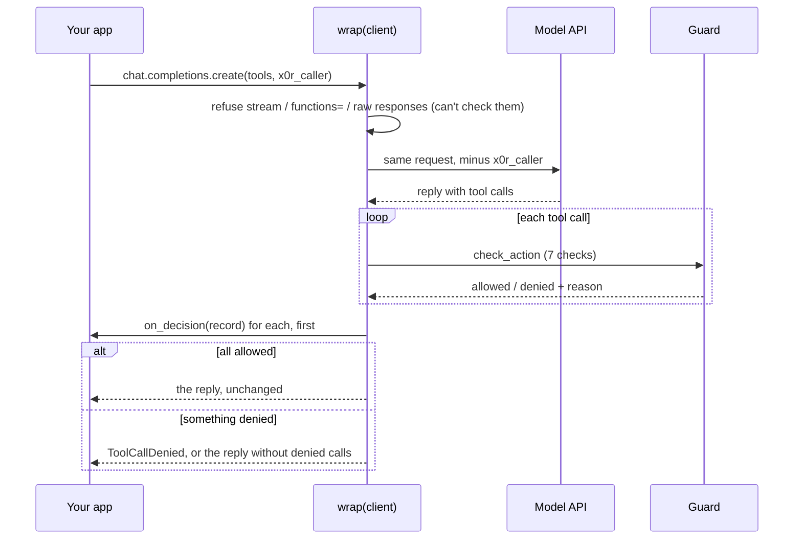

# Guarding your own app: the SDK wrapper

Use the guard without running Core. Wrap your OpenAI-compatible client, and every tool
call that comes back from `chat.completions.create()` or `.parse()` is checked before your
code sees it. Paths the wrapper can't check are refused, not passed through.

```python
from openai import OpenAI
from x0r_guard import Caller, Policy, wrap

client = wrap(OpenAI(), Policy(allow=["lookup_order", "refund_order"]))

reply = client.chat.completions.create(
    model="gpt-4o-mini",
    messages=messages,
    tools=TOOLS,
    x0r_caller=Caller("user-42", {"orders": "A-1,A-2"}),   # optional: who this is for
)
# Every tool call left in `reply` passed the guard. Run them as usual.
```

A full, runnable example is in [`examples/sdk_wrapper.py`](../examples/sdk_wrapper.py). It
runs offline by default. Add `--play` to type requests yourself and watch the guard allow or
block them, and `--live` to use a real model with your `OPENAI_API_KEY`.

## How it works



The same seven checks as Core run here. In the wrapper they mean:

| Check | In the wrapper |
| --- | --- |
| Agent granted the tool | The tool was offered in this request's `tools=` |
| Operator allows it | The tool is in `Policy.allow` |
| Arguments | The tool's JSON schema from `tools=`: types, required, lengths, ranges, `enum`, `const`, no extras. Invalid JSON is denied. The guard reads an allowlist of schema keywords. A schema that uses any other keyword (`pattern`, `format`, `anyOf`, `$ref`, `minProperties`, ...) is denied, at the root or on a property, so no constraint is skipped silently |
| Tool's own rule | `Policy.rules[name](arguments, ctx)`, where `ctx` has `caller`, `tool_call_id` and `config` |

On top of those, a tool call with no ID or with an ID already used in the same reply is
denied (`missing_tool_call_id`, `duplicate_tool_call_id`), so each result maps to one call.
A request that offers the same tool name twice is refused before it is sent.

The wrapper copies `tools=` and the caller when the request starts. The copy is what gets
sent and checked, so changing either while a request is in flight changes nothing.

## The policy

```python
Policy(
    allow=["lookup_order", "refund_order"],          # operator allowlist
    rules={"refund_order": small_refunds_only},      # optional business rules
    config={"max_refund": 50},                       # reaches rules as ctx.config
    on_decision=save_decision,                       # store every decision here
    on_denied="raise",                               # or "remove"
)
```

- **`on_decision`** gets a `DecisionRecord`: tool, tool-call ID, allowed, reason, caller
  subject, policy version and time. It never holds argument values. When you set it, it
  is called for every decision before the reply is returned. If it raises, the reply is
  withheld (`DecisionNotRecorded`). It must be a plain function: an `async` one is
  rejected, because the reply would go out before the record was saved. Leave it unset
  and nothing is recorded.
- **`on_denied="raise"`** raises `ToolCallDenied`, which has `.denied`, `.decisions` and
  `.response`. **`"remove"`** returns the reply. Either way the denied tool calls are
  already gone from that reply. If none are left, `tool_calls` becomes `None` and
  `finish_reason` becomes `"stop"`.
- The policy is frozen when you make it: changing the list you passed as `allow` later
  changes nothing. `config` is passed as is, so don't change it while requests run.

## Policy files

Load a version 1 TOML policy with the SDK.

```python
policy = Policy.from_file("examples/policy.toml", on_decision=save_decision)
```

Set `version = 1`, list permitted tools in `allow`, and add rules under
`[rules.<tool>]` as needed. All rules for a tool must pass. The guard reports the
first failing rule in file order.

| Rule | Fields | When it passes |
| --- | --- | --- |
| `caller_owns` | `argument`, `attribute` | The argument matches the caller attribute string or an exact member of its tuple |
| `max` / `min` | `argument`, `value` | The numeric argument is within the inclusive bound |
| `one_of` | `argument`, `values` | The argument equals one of the listed strings, booleans or finite numbers |
| `caller_has` | `attribute`, `value` | The caller attribute equals the given string |
| `deny` | `reason` | Always denies with the supplied reason |

Invalid files raise `PolicyFileError` during loading. Pass `rules=` to add Python
rules for tools without file rules. The SHA-256 of the exact file bytes is available
as `policy.policy_digest` and is included in each decision record. Policies built
directly in Python default to `None` for that field.

See the [example policy](../examples/policy.toml).

## What it guards, and what it refuses

| Path | Behavior |
| --- | --- |
| `chat.completions.create()` / `.parse()`, sync or async | Checked |
| `client.with_options()` / `client.copy()` | Return a client that's still guarded |
| `models`, `embeddings`, `files`, `images`, `audio`, `moderations`, `fine_tuning`, `batches`, `uploads`, `vector_stores`, `containers` and the client's settings | Passed through |
| `stream=True`, `functions=`, `function_call=` | Refused (`UnguardedCall`) |
| `extra_body` that sets `tools`, `tool_choice`, `stream`, `n` or the legacy function keys | Refused (`UnguardedCall`) |
| The raw-response header, per request or as a client default | Refused before anything is sent (`UnguardedCall`) |
| A reply that isn't a chat completion | Refused (`UnguardedCall`) |
| Every other client attribute: `responses`, `beta`, `completions`, `post()`, `request()`, `with_raw_response`, `realtime`, ... | Refused (`UnguardedAttribute`) |
| Tool calls of a type other than `function` | Denied (`unsupported_tool_type`) |
| An SDK error that carries the completion (`parse()` on a cut-off reply) | Its tool calls are checked before the error reaches you |

Pass-through is an allowlist. A path is refused rather than passed through because a
passed-through path would let tool calls skip the guard without anyone noticing, and a
new SDK path stays closed until someone checks it. Streaming and the Responses API are
next on the list.

## Works with

Any client with the OpenAI shape: `OpenAI`, `AsyncOpenAI` and `AzureOpenAI`, or the same
client pointed at OpenRouter, Groq, Together, vLLM, Ollama or LM Studio. Plain-dict replies
work too. The wrapper itself imports only the Python standard library.

`create()` works with any 1.x `openai`. `parse()` needs a version that has
`chat.completions.parse()`, which is 1.92 or later. Older versions only offer it under
`client.beta`, which is refused.

`with wrap(OpenAI(), policy) as client:` and `async with` work as they do on the client.

## Limits

- The caller is whatever your app passes. The wrapper runs inside your app, so it trusts
  your code. Private attributes (`_client` and the like) reach the unwrapped client and
  are outside what the wrapper promises.
- Rules see the arguments as decoded JSON. With `parse()`, the SDK also builds
  `parsed_arguments` from your Pydantic models. If a validator there changed a value, the
  call is denied (`parsed_arguments_changed`), so what you run is what was checked.
- The wrapper checks tool calls; it doesn't run them. Your code runs the allowed ones, so a
  tool's handler must still be safe with any valid input.
- Decisions are only as durable as your `on_decision`. Write them somewhere that survives a
  crash before you run the tool.
